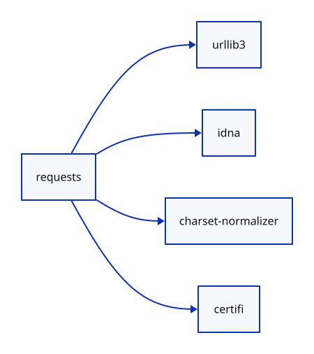
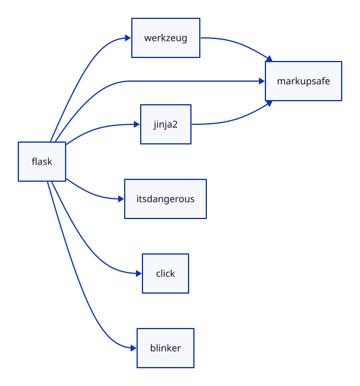
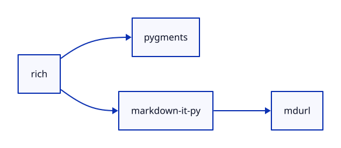

# Сравнение с pipdeptree

Проверка выполнена 28 октября 2026 года на macOS arm64, Python 3.14.0.
Сборщик проекта получал метаданные непосредственно из PyPI через urllib.
Для независимого сравнения использован pipdeptree 2.28.0 в отдельном
временном окружении. Код приложения не читает его вывод и не импортирует
pip, pipdeptree или packaging.

| Пакет | Версия корня | Вершины | Рёбра | Сравнение |
| --- | --- | ---: | ---: | --- |
| requests | 2.34.2 | 5 | 4 | Связи совпали |
| flask | 3.1.3 | 7 | 8 | Связи совпали |
| rich | 15.0.0 | 4 | 3 | Связи совпали |

Сравнивались множества вершин и направленных рёбер, а не порядок строк
или повторное отображение общей зависимости в дереве. У Flask общая
зависимость MarkupSafe связана с несколькими родителями: в дереве она
показывается повторно, в нашем графе это одна вершина.

В этой проверке версии установленных пакетов совпали с последними
версиями из PyPI. В общем случае результаты могут отличаться:
pip разрешает ограничения версий и устанавливает совместимый набор,
а наш инструмент строит граф последних метаданных каждого пакета.
Также результат зависит от Python, ОС и выбранных extras.

## Как повторить сравнение

В отдельном окружении установите requests, flask, rich и pipdeptree.
Эти команды нужны только для сравнения, для запуска проекта они не нужны.

```sh
python3 -m venv reference-env
reference-env/bin/python -m pip install requests flask rich pipdeptree==2.28.0
reference-env/bin/python -m pipdeptree --packages requests --json-tree
reference-env/bin/python -m pipdeptree --packages flask --json-tree
reference-env/bin/python -m pipdeptree --packages rich --json-tree
```

Исходные метаданные, окружение и графы сохранены в `examples/*.json`,
вывод независимого инструмента в `reference/*.json` и `reference/*.txt`.
Их нельзя использовать как вход сборщика вместо реального репозитория.
Графы D2 находятся в `examples/*.d2`, иллюстрации в `images/*.svg`.

Для просмотра и повторной отрисовки установите D2 из официального релиза:
https://d2lang.com/tour/install/

```sh
d2 docs/examples/requests.d2 output/requests.svg
d2 docs/examples/flask.d2 output/flask.svg
d2 docs/examples/rich.d2 output/rich.svg
```

D2 используется только для отрисовки уже полученного графа.

## Requests



## Flask



## Rich


